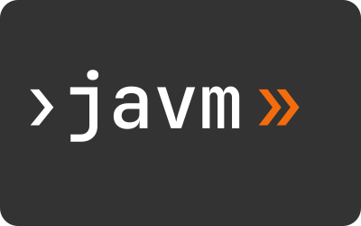

<p align="center">

</p>

<p align="center">
  <a href="https://github.com/felipebz/javm/releases"></a>
  <a href="https://github.com/felipebz/javm/actions/workflows/build.yml"></a>
  <a href="https://scorecard.dev/viewer/?uri=github.com/felipebz/javm"></a>
  <a href="https://javm.dev/docs/"></a>
  <a href="LICENSE"></a>
</p>

**javm** is a Java version manager for Linux, macOS, and Windows. It installs JDKs from distributions such as Temurin,
Zulu, Corretto, and GraalVM, finds the JDKs already on your machine, and selects the one a project asks for in
`.java-version`, without changing your system Java. It is a single static binary with no JVM required, and a
maintained fork of [jabba](https://github.com/shyiko/jabba).

**Documentation: [javm.dev](https://javm.dev/docs/)**

<p align="center">
  
</p>

## Features

- Install JDKs from any distribution listed by the Foojay Disco API, selected by version or range
  (`21`, `~17.0.2`, `^17.0.1`, `>=21 <22`, `17 - 21`, `17 || 21`)
- Per-project JDK via `.java-version`
- Run a single command with a JDK (`javm exec`), or switch the current shell (`javm use`)
- Native on Windows (PowerShell, Command Prompt), Linux, and macOS (Bash, Zsh, Fish, Nushell); no WSL or Git Bash
- Reuse JDKs installed by the system, IntelliJ IDEA, Gradle, or jabba
- Keep installed JDKs up to date with `javm update`
- Stable exit codes for scripts and CI
- Prebuilt binaries for Linux, macOS, and Windows on amd64 and arm64

javm is before 1.0: commands and configuration may still change between minor versions. Pin a release tag when you
need reproducible setups.

## Quick start

```bash
curl -fsSL https://javm.dev/install.sh | bash    # Windows PowerShell: irm https://javm.dev/install.ps1 | iex
javm install temurin@25
javm exec --jdk temurin@25 java --version
```

`javm exec` works without any shell setup. Add the [shell integration](#shell-setup) when you also want
`javm use` to switch `java` and `JAVA_HOME` in the current shell.

## Installation

### Linux and macOS

```bash
curl -fsSL https://javm.dev/install.sh | bash
```

The installer places the binary at `$HOME/.local/bin/javm` and does not edit shell profiles. If `javm --version`
reports `command not found`, add that directory to `PATH`:

```bash
export PATH="$HOME/.local/bin:$PATH"   # add this line to your shell profile to make it permanent
```

### Windows

```powershell
irm https://javm.dev/install.ps1 | iex
```

The installer places `javm.exe` in `%LOCALAPPDATA%\Programs\javm` and adds that directory to the user `PATH`.

### Versions, verification, and removal

<!-- x-release-please-start-version -->
Both installers accept `nightly` or a release tag such as `v0.17.0`, always verify the SHA-256 checksum, and can
optionally verify build provenance with `JAVM_VERIFY_ATTESTATION=1`. See the
[installation guide](https://javm.dev/docs/install/) for these options, upgrades, and
[uninstalling javm](https://javm.dev/docs/install/#uninstall-javm), and [ATTESTATION.md](ATTESTATION.md) for the
trust model.
<!-- x-release-please-end -->

## Shell setup

Shell integration is optional: only `javm use` and `javm deactivate` need it to change the current shell. Add the
line for your shell to its profile and restart the shell:

| Shell | Profile | Line |
| --- | --- | --- |
| Bash | `~/.bashrc` | `eval "$(javm init bash)"` |
| Zsh | `~/.zshrc` | `eval "$(javm init zsh)"` |
| Fish | `~/.config/fish/config.fish` | `javm init fish \| source` |
| PowerShell | `$PROFILE` | `iex "$(javm init pwsh)"` |

Nushell and Command Prompt use a generated script or wrapper; see
[Shell setup](https://javm.dev/docs/install/#shell-setup).

## Usage

### Pick a JDK per project

```sh
echo 21 > .java-version
javm install                 # installs the version from .java-version
javm exec ./gradlew build    # runs the build with that JDK
javm use                     # or switch the current shell to it
```

javm does not switch automatically when you change directories.

### Find and install JDKs

```sh
javm ls-remote                                 # latest Temurin build per major version (default distribution)
javm ls-remote --distribution all              # every distribution
javm ls-remote ">=8 <9" --distribution zulu    # filter by range and distribution
javm install temurin@21
javm install zulu@8
javm install corretto@~21.0.2
```

With `ls-remote`, choose the distribution with `--distribution`. Java 8 and older use modern version numbers:
write `8` or `8.0.400`, not `1.8`.

### Run a command with a JDK

```sh
javm exec mvn test                         # JDK from .java-version
javm exec --jdk 21 java --version
javm exec --jdk temurin@21 ./gradlew build
```

Only the child process gets the selected `JAVA_HOME` and `PATH`; the current shell is unchanged.

### Switch the current shell

```sh
javm use temurin@21
javm current                 # show the JDK active in this shell
javm deactivate              # restore the previous JAVA_HOME and PATH
javm default temurin@21      # JDK for new shells
```

### Manage installed JDKs

```sh
javm ls                      # JDKs on this machine, with the selectors that pick them
javm ls --details            # include source, vendor, architecture, and path
javm update                  # update every installed distribution@feature line
javm update --dry-run        # list available updates without installing
javm uninstall zulu@8
javm link system@21.0.1 /path/to/jdk   # register a JDK installed outside javm
javm alias project temurin@21          # name a selector; use it with javm use project
```

See the [CLI reference](https://javm.dev/docs/reference/) for every command, flag, selector, configuration key, and
[exit code](https://javm.dev/docs/reference/#exit-codes), and the
[troubleshooting guide](https://javm.dev/docs/how-to/troubleshooting/) when something does not work.

### Use in CI

On Linux and macOS runners, install a pinned javm release, install the JDK from `.java-version`, and run the build
through `javm exec`:

<!-- x-release-please-start-version -->
```yaml
- run: |
    curl -fsSL https://javm.dev/install.sh | bash -s v0.17.0
    echo "$HOME/.local/bin" >> "$GITHUB_PATH"
- run: javm install
- run: javm exec ./gradlew build
```
<!-- x-release-please-end -->

Windows runners and other CI systems: see [Use javm in CI](https://javm.dev/docs/how-to/use-javm-in-ci/).

## Coming from jabba

javm started as a fork of jabba. It discovers JDKs installed by jabba, so `javm ls` and `javm use` can select them
without reinstalling, and `javm use` leaves jabba's `PATH` entries untouched. javm keeps its own data in `JAVM_HOME`
and reads `.java-version` instead of `.jabbarc`. See [Migrate from jabba](https://javm.dev/docs/how-to/migrate-from-jabba/).

## Data location

javm stores managed JDKs, configuration, and caches in `JAVM_HOME`: `~/.local/share/javm` (or
`$XDG_DATA_HOME/javm`) on Linux, `~/Library/Application Support/javm` on macOS, and `%LOCALAPPDATA%\javm` on Windows.
Set the `JAVM_HOME` environment variable to use another directory.

## Coding agents

javm includes an agent skill for coding agents that need to run Java tools with a predictable JDK:

```bash
npx skills add felipebz/javm --skill javm -g
```

The skill teaches agents to prefer `javm exec` for builds, tests and other non-interactive Java commands.

## FAQ

**Does javm change my system Java?**\
No. `javm use` changes `PATH` and `JAVA_HOME` only in the current shell, and `javm exec` only for the command it runs.
javm never edits system alternatives, the Windows registry, or shell profiles.

**How do I go back to the system JDK?**\
Run `javm deactivate`, or open a new shell if no default is set with `javm default`.

**How is javm different from SDKMAN, jEnv, or mise?**\
javm is a single native binary that runs in PowerShell and Command Prompt as well as Unix shells, without WSL or
Git Bash. Unlike jEnv, it downloads JDKs itself; unlike general-purpose tool managers, it focuses on JDKs, with Java
version ranges, discovery of existing JDKs, and `javm exec` for builds.

## Development

Prerequisite: Go **1.27**

```sh
git clone https://github.com/felipebz/javm
cd javm
go test ./...
go build -o javm .
./javm --help
```

Report bugs and request features in [GitHub Issues](https://github.com/felipebz/javm/issues). Pull requests are
welcome; [CONTRIBUTING.md](CONTRIBUTING.md) describes the process and what a change needs (tests, `gofmt`,
Conventional Commits). Release notes are in [CHANGELOG.md](CHANGELOG.md); report vulnerabilities privately as described
in [SECURITY.md](SECURITY.md).

## License

Apache-2.0. See [LICENSE](LICENSE).
